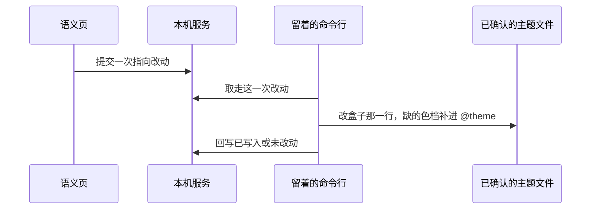

# 工单：语义指向写回

## 职责

扫描接入之后，命令行留在项目目录。网页确认一次语义指向的改动，服务把这一次改动交给留着的命令行，命令行写入已经确认的主题文件。开发服务器保存后自行更新页面。

这一单只改颜色盒子的指向。不生成规则包，不运行检查，不改组件文件。

## 命令怎么留着

`scan` 保持一次检测、一次上传、然后退出。新增一条命令，沿用同一套任务编号、令牌和本机服务地址。它先做一次现有检测：

- Tailwind 必须是已安装的第四版。
- 主题路径必须已经由用户确认。官方查询到的路径只是候选，确认前不写。
- 项目必须是单应用。

三项不满足就退出，不进入等待。满足之后命令不退出，按固定间隔向服务询问有没有新的改动。服务没有改动时返回空。用户结束命令后，网页上的写回停在未送达，不另找程序去改文件。

## 一次改动写什么

一次改动只有三样：盒子名、浅色或深色、阶梯上的档名。例如浅色 `primary` 指向 `blue-600`。

盒子名来自阶段一工单六那份默认盒子，但 `radius` 不是颜色，不接受。档名和颜色数字来自基础阶梯。服务只保存这三样，不接收一段 CSS，也不接收项目源码。

命令行拿到改动后只做两件事：

- 在 `:root` 或 `.dark` 里，把已有的那只盒子改成 `var(--color-档名)`。文件里没有这只盒子就停，不新造盒子。
- `@theme` 里还没有这一档时，补上 `--color-档名` 和阶梯里的颜色数字。已有的档不改值。

写入前先读文件。目标行无法唯一确定，或写入中途失败，文件保持原样，服务记录未改动。`node_modules` 不改。

## 网页以后怎么接

语义页先在浏览器里改预览。用户确认写回时，页面把这三样提交给本机服务。页面不直接打开项目文件。

服务按提交顺序保存。留着的命令行一次取走一件，写完再取下一件。同一只盒子的浅色和深色是两件，可以先后提交。

页面查询每一件的状态：等待命令行、已写入、未改动。命令行不在时，状态停在等待命令行。这个接口以后给正式语义页用；本工单用现有演示页或一条请求验证，不顺手做阶段一工单三的接入网页。

## 验收

在 `F:\lint-shadcn-tailwind-test` 上：

- 命令留在项目目录，浅色 `primary` 从 `neutral-900` 改为 `blue-600`。`src/index.css` 的 `:root` 改为 `var(--color-blue-600)`，`@theme` 补上这一档。按钮变成蓝。
- 再改回 `neutral-900`。按钮恢复近黑，已有的 `--color-neutral-900` 不被重写。
- 主题路径未确认、盒子不存在、档名不在阶梯里、命令行没留着，这四种情况都不改文件。
- 服务里看不到项目源码，只能看到这一次的盒子、模式和档名。

依赖：阶段一工单二、工单七。基础阶梯和当前对齐结果已在 `demos/design-system`。
