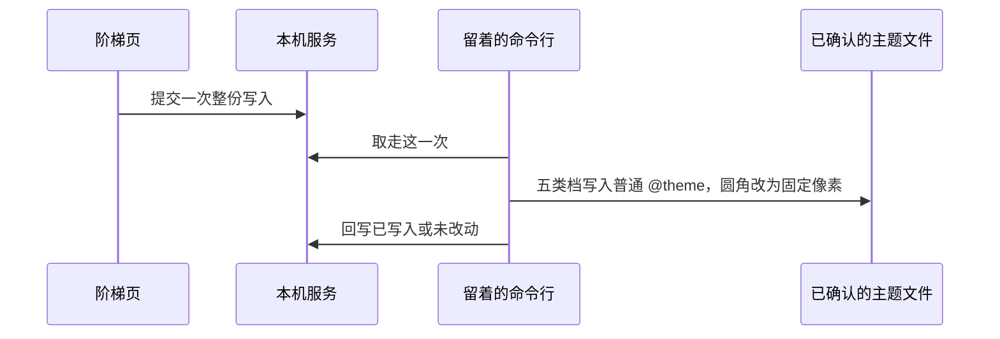

# 工单：尺寸阶梯写入主题

## 职责

颜色盒子的指向已经能写回。这一单把基础阶梯上的间距、字号、字重、圆角、阴影整份写进已经确认的主题文件。

这五类没有语义盒子。浅色和深色用同一套数字，不经过 `:root` 和 `.dark`。组件继续写 `p-4`、`text-sm`、`font-medium`、`rounded-lg`、`shadow-sm`，只改主题里的值。

不生成规则包，不运行检查，不改组件文件，不改 `node_modules`。



## 一次写入什么

一次写入是整份阶梯，不是一档。档名和值来自基础阶梯：

| 类别 | 档 | 主题变量 |
|---|---|---|
| 间距 | `1` `2` `3` `4` `6` `8` `12` `16` `24` `32` `48` `64` `96` `128` `160` `192` | `--spacing-4: 16px` |
| 字号 | `xs` 到 `7xl`，每档另有行高 | `--text-sm: 14px` 和 `--text-sm--line-height: 1.5` |
| 字重 | `normal` `medium` `semibold` `bold` | `--font-weight-medium: 500` |
| 圆角 | `sm` `md` `lg` `xl` `2xl` | `--radius-lg: 8px` |
| 阴影 | `xs` `sm` `md` `lg` `xl` | `--shadow-sm: …` |

圆角的阶梯名字是像素，类名仍用 Tailwind 的名字。对应关系固定为：

| 类名档 | 阶梯档 | 值 |
|---|---|---|
| `sm` | `4` | `4px` |
| `md` | `8` | `8px` |
| `lg` | `12` | `12px` |
| `xl` | `16` | `16px` |
| `2xl` | `16` | `16px` |

`2xl` 和 `xl` 这一轮共用 `16px`。阶梯上的 `0` 不写入，`rounded-none` 继续用 Tailwind 自带的 `0px`。

## 文件怎么改

只打开已经确认的主题文件。普通 `@theme`、`:root`、`.dark` 各出现一次才写。缺一块或出现两次，文件保持原样。

普通 `@theme` 里：

- 间距先写 `--spacing: initial`，再写上表里的每一档。`initial` 关掉默认的「底数乘档号」。没写上的 `p-7`、`px-2.5`、`h-7` 不再按 `0.25rem` 生成。
- 字号、字重、阴影按上表追加。某一档已经存在就不改它的值。
- 不改已经在里面的颜色档。

`@theme inline` 里现有的圆角是 `--radius` 乘系数，写在普通 `@theme` 后面，同名会盖住固定像素。把这七行改成固定像素：

```css
--radius-sm: 4px;
--radius-md: 8px;
--radius-lg: 12px;
--radius-xl: 16px;
--radius-2xl: 16px;
--radius-3xl: 16px;
--radius-4xl: 16px;
```

`3xl`、`4xl` 这一轮也用 `16px`。`:root` 里的 `--radius: 0.625rem` 留着，不再参与计算。`@theme inline` 里的颜色登记和字体登记不改。

写入前先读文件。目标行无法唯一确定，或写入中途失败，文件保持原样。

## 网页怎么接

阶梯页确认一次，就提交这一次整份写入。页面不直接打开项目文件，也不逐档提交。

服务按提交顺序保存。留着的命令行一次取走一件。页面查询这一件的状态：等待命令行、已写入、未改动。

正式阶梯页以后调用同一组接口。这一单用现有阶梯页上的一个动作验证，不顺手做阶段一工单三的接入网页。

## 验收

在 `F:\lint-shadcn-tailwind-test` 上：

- 命令留在项目目录。写入后，`src/index.css` 的普通 `@theme` 有 `--spacing: initial`、`--spacing-4: 16px`、`--text-sm: 14px`、`--font-weight-medium: 500`、`--shadow-sm`。
- `@theme inline` 的 `--radius-lg` 变成 `12px`，不再是 `var(--radius)`。按钮的 `rounded-lg` 变成 12 像素。
- 浅色 `--primary: var(--color-blue-600)` 保持不动。已经写过的 `--color-blue-600` 不被重写。
- 主题路径未确认、三块无法唯一确定、命令行没留着，这三种情况都不改文件。
- 服务里看不到项目源码，只能看到这一次要写入的档名和值。

依赖：阶段二工单「语义指向写回」。基础阶梯在 `demos/design-system/base.js`。
