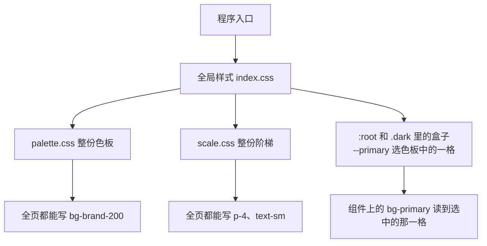

# 色板、阶梯和全局样式

颜色数字和尺寸数字分开存放。全局样式只导入一次，全页因此都能用这些值。shadcn 的颜色盒子只从色板里选用一部分。

## 文件怎么接



程序入口加载全局样式。色板文件和阶梯文件都从这里导入，不在各个组件里重复导入。Tailwind 只处理这条链上的样式，所以导入一次之后，类名在整个页面里都能用。

```css
@import "tailwindcss";
@import "./palette.css";
@import "./scale.css";
```

全局样式的文件名不固定，常见的是 `src/index.css` 或 `app/globals.css`。

## 色板

`palette.css` 用 `@theme` 写下全部颜色数字，例如中性色、品牌色、危险色，每色多档。这里是项目里唯一写颜色数字的地方。

导入之后，每一档都是 Tailwind 颜色。页面可以写 `bg-brand-200`、`bg-neutral-700`。

shadcn 的盒子不把整套色板再抄一遍。每只盒子选一格，浅色和深色可以选不同的格：

```css
:root {
  --background: var(--color-neutral-50);
  --foreground: var(--color-neutral-950);
  --primary: var(--color-brand-600);
  --primary-foreground: var(--color-neutral-50);
}

.dark {
  --primary: var(--color-brand-300);
}
```

没有被选中的档仍留在色板里，只是不担任“页面背景”或“主要按钮”这些角色。

类名登记保持指向盒子，不直接指向色板的某一格：

```css
@theme inline {
  --color-primary: var(--primary);
}
```

因此 `bg-primary` 先打开 `--primary`，再拿到当前这一格。深色里换成另一格时，类名不用改。组件里写着 `var(--primary)` 的地方和类名读到的是同一只盒子。

## 阶梯

`scale.css` 同样用 `@theme`，放间距、字号和圆角。整份导入，不从中挑一部分再写入全局样式。组件只用其中几档，例如 `h-8`、`px-2.5`、`text-sm`。其余档留给页面。

间距和字号的接法不同。

Tailwind 自带的间距只有一个底数 `--spacing: 0.25rem`。`p-4` 是底数乘以 4，`h-8` 永远是 `p-4` 的两倍。自家的阶梯如果不是这种固定倍数，就要给组件已经在用的档单独写值，例如 `--spacing-2`、`--spacing-2.5`、`--spacing-4`、`--spacing-8`。写了 `--spacing-4` 之后，`p-4` 用这一档的数字，不再表示四倍。没有写到的默认倍数档要清掉，避免 `p-7` 这类档仍按旧倍数存在。

字号本来就是一档一个值。`text-sm` 对应 `--text-sm`，并带有 `--text-sm--line-height`。换成阶梯上的字号和行高即可，类名不变。`text-xs`、`text-base`、`text-lg` 同样处理。

圆角如果也不是一个底数乘系数，就不要再用 `calc(var(--radius) * 0.8)` 这种写法。每一档直接写成阶梯上的尺寸，类名 `rounded-md` 仍然可用。

## 全局样式里留下的内容

| 内容 | 处理 |
|---|---|
| `@import` 色板和阶梯 | 保留。这是整页的入口 |
| `:root`、`.dark` 里的颜色盒子 | 值改成色板引用，名字保留 |
| `@theme inline` 里的 `--color-primary: var(--primary)` | 保留。这是类名登记 |
| 组件和页面上的 `bg-primary`、`h-8`、`text-sm` | 不改。类名已经指向盒子或阶梯 |

这一步不检查页面是否写了色板以外的颜色或任意尺寸。那是之后的规则要做的事。
