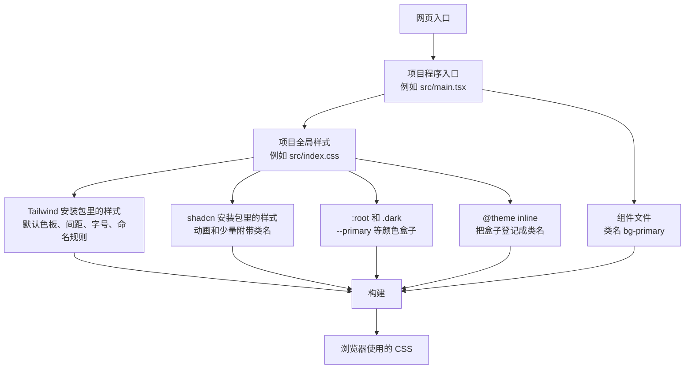
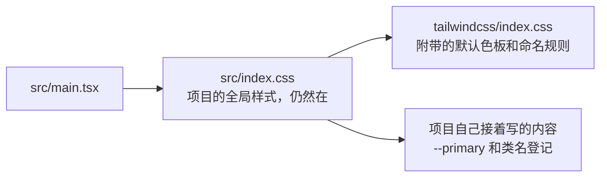
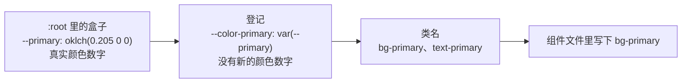
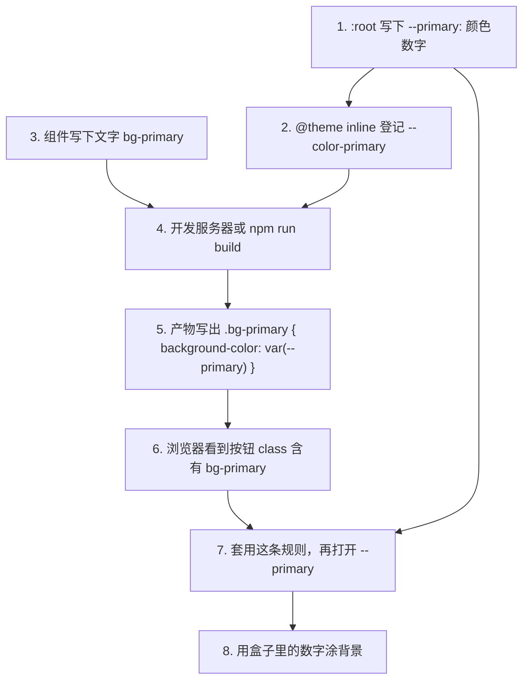
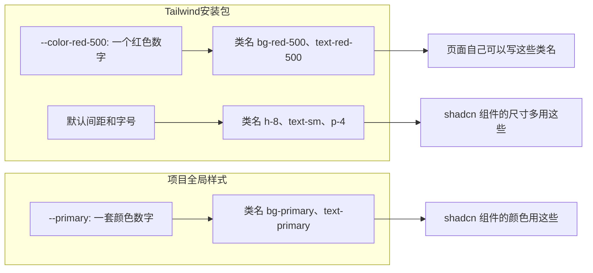

# Tailwind、shadcn 和全局样式

这份说明只整理已经讲清的关系：文件谁引用谁，颜色数字放在哪，类名怎么来。

## 总关系

项目有一份自己的全局样式。它负责把 Tailwind 引进来，也负责存放 shadcn 的颜色盒子。按钮文件里只有类名，没有颜色数字。构建之后，浏览器读的是生成出来的那一个 CSS 文件。



## 两份都叫 index.css 的文件

`index.css` 只是文件名，意思是“这一包东西的主样式”。CSS 没有规定必须叫这个名字。常见项目里会同时存在两份：

| 文件 | 谁拥有 | 作用 |
|---|---|---|
| 项目里的全局样式，例如 `src/index.css` 或 `app/globals.css` | 项目 | 页面真正的样式入口。程序入口导入这一份 |
| Tailwind 安装包里的 `node_modules/tailwindcss/index.css` | Tailwind | 默认色板、字体、间距、圆角，以及基础重置 |

项目入口导入的是项目自己的那一份：

```css
/* src/main.tsx */
import './index.css'
```

项目这份的第一行再打开 Tailwind 那一份：

```css
@import "tailwindcss";
```



Tailwind 的文件没有取代项目的全局样式。两份一起生效：红、蓝、灰、间距和字号来自 Tailwind；`--primary` 来自项目文件。

## 全局样式里的四段

一份接好 Tailwind 和 shadcn 的全局样式，通常按这个顺序：

```css
@import "tailwindcss";
@import "tw-animate-css";
@import "shadcn/tailwind.css";

:root {
  --primary: oklch(0.205 0 0);
}

.dark {
  --primary: oklch(0.922 0 0);
}

@theme inline {
  --color-primary: var(--primary);
}
```

| 段落 | 里面是什么 |
|---|---|
| `@import "tailwindcss"` | 引入默认色板、间距、字号和命名规则 |
| `@import "shadcn/tailwind.css"` | 引入 shadcn 安装包里的动画和 `no-scrollbar` 这类类名。这里没有 `--primary` |
| `:root` 和 `.dark` | 颜色盒子。数字写在这里 |
| `@theme inline` | 登记。告诉 Tailwind：请为这个盒子生成类名 |

`tw-animate-css` 和字体导入是 shadcn 初始化时常一并加进来的其他包，不是 Tailwind 色板，也不是 `--primary`。

## 盒子、登记、类名

这是三样不同的东西。



`:root` 是整页最外层。写在这里的盒子，页面上任何地方都能用。`.dark` 表示页面处于深色。同一批盒子在这里换成另一套数字。

`--primary` 这个名字表示用途：主要操作的颜色。它不表示“蓝色 600”。盒子里的 `oklch(...)` 才是颜色数字。`oklch` 只是写颜色的一种记法。

登记写在 `@theme inline` 里：

```css
--color-primary: var(--primary);
```

`--color-` 是 Tailwind 规定的颜色前缀。前缀后面的 `primary` 是这次登记的颜色名。这一行本身不是类名。构建时，编译器读到它，才允许生成 `bg-primary`、`text-primary`、`border-primary`。

`inline` 的作用是：生成出的类里写 `var(--primary)`，不在构建时把颜色数字抄死进类里。所以后来盒子里的数字变了，类名不用改。

组件文件里的 `bg-primary` 此时还只是文字。构建之后，产物里会出现：

```css
.bg-primary {
  background-color: var(--primary);
}
```

浏览器只认这条规则。它不阅读 `@theme`。

## `bg-primary` 这个名字是谁定的

类名按 Tailwind 的拼法拆开：

```text
hover : bg - primary / 80
```

| 这一段 | 谁定的 | 含义 |
|---|---|---|
| `hover:` | Tailwind | 鼠标放在上面时才使用后面的设置 |
| `bg` | Tailwind | 改背景颜色。同一套缩写里，`text` 改文字颜色，`border` 改边框颜色 |
| `primary` | 写主题的人。shadcn 选用了这个词 | 使用已登记、名叫 primary 的颜色 |
| `/80` | Tailwind | 这个颜色用 80% 的浓度 |

浏览器不认识 `bg`，也不认识 `primary`。它只认识构建后写出的 `background-color`。

`primary` 能当颜色用，是因为它登记在 `--color-` 下面。如果登记成 `--radius-sm`，它就是圆角，类名是 `rounded-sm`。状态用冒号左边的写法，例如 `hover:`、`disabled:`。`primary` 不是状态。

源码里没有写到的类名，构建结果里就不会出现。登记只说明这个名字合法；组件里真的写了 `bg-primary`，对应规则才会被写出来。

## 从源码到屏幕



命名规则在编译时生效。开发服务器和 `npm run build` 都会做这一步。浏览器打开页面时，才把 `var(--primary)` 换成盒子里的数字。

深色不再生成新类名。页面进入深色后，`.dark` 把同一个 `--primary` 换成另一个数字。按钮的 class 仍是 `bg-primary`，背景用新数字重新涂色。

`@theme` 必须写在文件顶层，不能放进 `.dark`。所以明暗切换写在 `:root` 和 `.dark` 的盒子上，不写在 Tailwind 的主题登记里。

## 两条颜色来源



Tailwind 提供默认色板和命名规则。`bg-red-500` 可以直接用。它不提供 `--primary`，也不提供 `bg-primary`。

shadcn 组件的颜色写的是 `bg-primary`、`bg-background`、`text-muted-foreground`、`border-input`。这些对应项目全局样式里的盒子。组件一般不写 `bg-blue-600`。

尺寸和字号则多用 Tailwind 已经定好的刻度，例如 `h-8`、`px-2.5`、`text-sm`、`rounded-lg`。这些表示尺寸，不随品牌色更换。

颜色单独放进盒子，是为了让组件源码保持“主要操作的颜色”这个用途。换品牌色或切换深色时，只改盒子里的数字，所有写着 `bg-primary` 的组件一起变。

## shadcn 的盒子写在哪里

初始化时，shadcn 按所选样式预设，把整套盒子一次写进项目的全局样式。`:root` 是浅色数字，`.dark` 是同一批名字的深色数字，`@theme inline` 是对应的类名登记。

`base-nova` 这套预设里，一次写上的名字包括：

- 页面：`background`、`foreground`
- 主要、次要、弱化、强调：`primary`、`secondary`、`muted`、`accent`，以及各自的 `-foreground`
- 表面：`card`、`popover`，以及各自的 `-foreground`
- 线条和焦点：`border`、`input`、`ring`
- 危险操作：`destructive`
- 图表：`chart-1` 到 `chart-5`
- 侧栏：`sidebar` 及其相关名字
- 圆角：`radius`。这是尺寸，不是颜色

这时项目里可能只安装了按钮、卡片和输入框，图表和侧栏的盒子也已经在文件里。它们属于这套外观的默认主题。当前官方组件登记不附带新的颜色盒子；登记格式允许以后的组件再写入新名字。详见 `docs/research/shadcn-style-tokens.md`。

安装包里的 `shadcn/dist/tailwind.css` 不包含这份名单。组件本身是复制进项目的程序文件，里面写类名，不写颜色数字。

默认情况下，盒子里是直接的颜色数字：

```css
:root {
  --primary: oklch(0.205 0 0);
}
```

这个数字不是 `red-500` 或 `blue-600`。它是为这套主题配好的颜色，常常落在色板两格之间。浅色和深色各有一对背景和字色。

盒子也可以改成引用色板：

```css
:root {
  --primary: var(--color-blue-600);
}
```

这是后来的写法。shadcn 默认给出的是直接数字。引用色板时，`bg-primary` 拿到的才是色板里的那一格。
